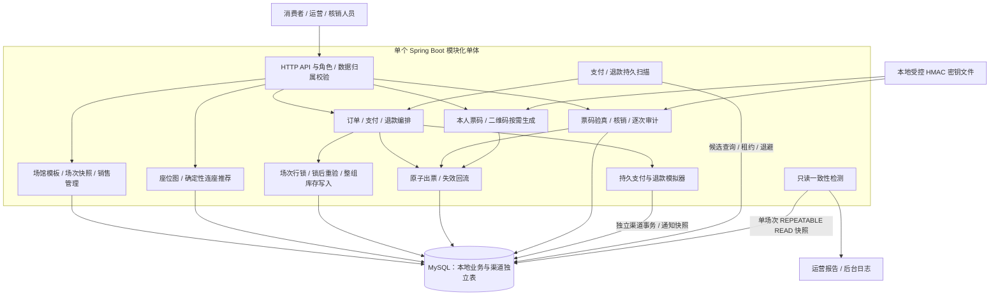

# 首版架构与可靠性边界

- 定稿日期：2026-10-21（Asia/Shanghai）
- 确认：负责人采纳本版保留场次行锁与 MySQL 持久扫描；分段锁作为后续对照，不引入 Redis、MQ 或延迟组件。具体理由见 ADR-0021 / ADR-0022。
- 本图描述业务运行架构。第七周额外启动的隔离 MySQL 只用于真实重启实验，不是部署时必须增加的业务组件。

## 事实来源与事务

场馆座位模板与场次座位分离，订单项保存成交快照。MySQL 保存订单、锁/明细、当前座位占用、支付、票、退款和核销审计；各自有独立状态，不能靠一个字段推断所有生命周期。

同场次销售管理、库存占用与释放遵守场次锁协议。下单在 READ COMMITTED 写事务中取得锁、取时间、读取最新库存并重验可售与孤座，整组订单/明细/锁/占用一起提交。不同场次有各自的锁；相同场次不同分段仍会等待。

渠道模块与本地模块目前处于同一进程和 MySQL 实例，但渠道事实使用独立事务。调用渠道期间不持有本地订单/库存锁；渠道成功不等于本地已完成出票或回流。原编号查单、通知重投和恢复扫描把已确认的渠道结果应用到本地完整事务。

本地支付成功、订单、全部座位/锁与出票同事务。退款成功、原票失效、座位回流和订单汇总同事务。核销的票迁移、成功审计与满足条件的订单完成汇总同事务。SQL 执行后抛异常应回滚全部本地变化；渠道此前已提交的事实保留，重试继续使用原编号。

## 检测、重试与恢复

支付/退款扫描按持久期限与恢复字段选候选，逐单重新核验，默认每轮结束一秒后再次运行、单批最多五十项。实际异常持久退避，工作领取使用六十秒租约与 token，旧 token 不能结算或清除新领取，可信渠道事实仍可幂等应用；达到既定阈值转人工，资金结果未知时保留占用。重启重新发现候选，内存游标不承担业务事实。

一致性检测在单场次只读一致快照中检查订单、票、库存、锁、支付、退款及审计。它报告本地矛盾，不直接修表；普通未决渠道流程继续走既有恢复协议。后台默认每轮结束六十秒、每批十场次，失败后重试，真正矛盾由运营核查。

## 保留的限制

- 同场次写入串行；本地有限波次实验不能代表生产容量。分段锁与 Redis 预占未实现，不能声称现有实现比它们更快。
- 应用停机期间不执行恢复；积压逐批处理。默认扫描间隔不构成到期释放时延承诺，未知支付不能因时间过去而强制释放。
- 模拟渠道没有真实跨机网络，不覆盖数据库宕机、持久卷损坏、主从切换或多 JVM 部署。
- 一致性报告没有持久报告表、外部告警或完整异常工单；人工标记需要运营介入。
- 静态二维码可被复制，成功核销审计不能证明持码者身份；入场截止后未到场订单批量归集暂缓。

## 证据导航

核心状态与并发规则见各 ADR 和[第七周评审](week-07-reliability-review.md)。自动化、组合故障、真实重启及性能观测的实际执行状态统一见[第七周周报](../progress/week-07.md)，不能以本架构文档代替测试或实测结果。
