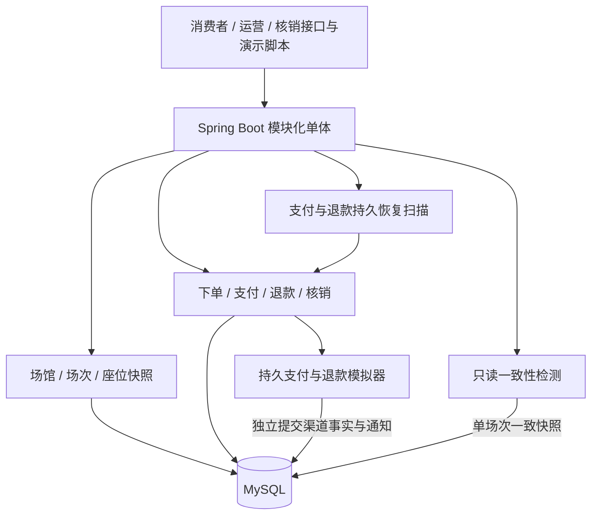

# 第七周可靠性实验与方案定稿评审

- 日期：2026-10-21（Asia/Shanghai）
- 状态：负责人于 2026-10-21 先选择“暂不定稿，先讨论替代方案”，讨论后明确回复“可以，你开始实行吧，现阶段采纳你的建议”。Q-10 据此已解决：现阶段保留场次行锁和 MySQL 持久扫描，分段锁留作后续对照，不引入 Redis、MQ 或延迟组件。本稿不代表替代方案已实现或已压测。
- 起点：第六周交付 `7bbb0cf`；本轮分支 `codex/week7-reliability`，原有 `img/` 保留。

## 本轮小闭环

业务闭环已有实现，第七周首先回答：一批人抢有交集的组合时，失败方是否留下部分占座；通知与恢复任务交错、结果确认失败时，是否重复出票或覆盖新的恢复工作。

沿用场次行锁、锁后最新校验、整组本地事务、渠道独立事实、原编号恢复及领取 token 协议。新增内容是测试、复现脚本和结果记录，不改变状态机、表结构、事务或并发协议。实验参数、已执行结果与限制另见[可靠性报告](../testing/week-07-reliability.md)。

## Q-10：需要解决的业务问题

当前同场次写入串行，热门场次的不同座位请求也会等待；应用停机时扫描停止，未决交易和超时占座要等重启后继续处理。引入其他组件必须能改善明确的问题，同时继续保证整组选座规则、安全关单、原子出票和失败恢复。

现有第四周基线测量的是完整 `OrderService.create`：100 / 500 座、并发 1 / 4 / 8、连接池上限 5，共 104 个正式样本。它没有测量锁等待占比、超时处理延迟或替代实现。因此只能作为当前实现的初始观测，不能证明 Redis 更快、消息队列更可靠或扫描能在一秒内释放座位。

## 锁座方案比较

| 维度 | A：当前 MySQL 场次行锁 | B：按座位分段细化锁定范围 | C：Redis 原子预占 + MySQL 落单 |
| --- | --- | --- | --- |
| 正确性前提 | 销售配置及库存写入遵守同场次锁，锁后重验孤座和库存，整组同事务 | 除选中座位外，覆盖孤座判断涉及的完整分段；销售配置与全部写入入口须形成一致协议，跨段按固定顺序加锁 | 原子处理整组、校验范围与请求身份；Redis 与 MySQL 间仍需解决成功、失败及中断恢复 |
| 已有吞吐证据 | 第四周六档服务调用样本与第七周同参数复测，各有串行对照；正确性实验不另算吞吐 | 未实现、未实测 | 未实现、未实测 |
| 可能收益 | 简单且可复核；不同场次有各自锁 | 同场次不相关分段有机会并行，尚未验证收益 | 预占与数据库负载隔离有可能获益，尚未验证 |
| 代价与故障边界 | 同场次并发受限；全场重验与连接等待计入请求耗时 | 锁顺序、孤座邻域和配置冻结更复杂，需重新覆盖支付/释放/退款/核销入口 | 增加双事实同步、过期与落单竞争、组件故障和补偿；Redis 过期本身不能证明支付未成功 |
| 当前判断 | 有实现和测试，可继续作为 MVP 基线 | 仅设计备选，不能把“只更新选中行”当作等价实现 | 仅设计备选，不能宣称有性能提升 |

只给选中座位做条件更新不足以替代现有锁：两组不重叠请求仍可能共同制造孤座，销售开关也可能在校验后变化。真正比较方案 B 前，需要先评审它如何覆盖这些读写边界，再实现并在相同条件下测量。

例如一段只有 1–5 五座：甲选 1/2，乙选 4/5，各自在初始库存下都合法；只锁各自选择的行，可能一起提交后留下孤座 3。分段锁方案需要让这两次请求在同一分段内依次重验，同时允许其他无关分段并行。手选跨排或跨过道时涉及多段，还须定义统一加锁顺序。

MySQL 可以对读取的记录加排他锁，但锁覆盖的业务范围仍须应用协议决定，见 [MySQL 8.4 锁定读取文档](https://dev.mysql.com/doc/refman/8.4/en/innodb-locking-reads.html)。Redis 脚本保证在 Redis 内原子执行，见 [Redis Lua 文档](https://redis.io/docs/latest/develop/programmability/eval-intro/)；这不能把本项目另一个存储中的 MySQL 落单一起变成同一个事务。因此 Redis 预占成功、MySQL 落单失败及响应丢失，需要额外的恢复设计；这是对本项目双存储方案的分析，并非替代实现的实测结果。

## 超时与恢复方案比较

| 维度 | A：当前 MySQL 持久扫描 | B：延迟消息触发 + MySQL 兜底扫描 |
| --- | --- | --- |
| 触发 | 批量读取到期/待恢复编号，逐单取得租约并重验 | 到期消息唤醒原订单恢复；消息只是提示，数据库仍决定能否执行 |
| 安全取消 | 查原支付，确认未成功并关单后才释放 | 必须复用完全相同的查单、关单、事务及租约规则 |
| 重复/乱序 | 幂等、锁内资格重验及 token 防止旧工作覆盖新工作 | 仍需同样保护，不能假设消息恰好一次或按时送达 |
| 停机恢复 | 从持久订单事实重新扫描；游标从头不会重新产生业务结果 | 依赖消息持久化、积压处理；发送中断仍需可靠投递机制或扫描补漏 |
| 性能证据 | 已有正确性、真实重启与有限健康积压观测；默认调度释放时延分布和生产容量未建立 | 未实现，吞吐和时延均未测 |
| 复杂度 | 现有部署；停机期间不处理，有限批次可能产生排队 | 新增 broker、投递与消费恢复、监控；为防漏仍保留兜底扫描 |

两组比较均区分实际测量与设计推演，吞吐列明确标注未实测，尚不构成两套实现的性能对照。后续若要得出性能优劣结论，必须先评审替代协议，再同条件实现与测量。

消息系统也需要面对确认丢失和重复投递。例如 [RabbitMQ 可靠性文档](https://www.rabbitmq.com/docs/reliability)明确要求消费者处理重复；本项目若引入它，现有幂等与恢复边界仍需保留，不能把增加 broker 等同于资金和库存天然一致。

## 已确认结论与后续顺序

Q-10 已确认结论为：本版继续使用 MySQL 场次行锁和持久扫描，不新增 Redis、MQ 或延迟组件，分段锁留作后续对照。理由是已有协议保护当前业务规则，并有可复核的正确性证据；目前没有替代实现收益的证据，新增锁协调或消息投递协议会增加复杂度。接受同场次串行与停机期间暂缓处理的限制，不据此认定已有方案满足任何生产容量目标，也不认定替代方案没有收益。

确认过程分为两步：首次“暂不定稿”时保持问题开放，未提前创建已接受决策；讨论完整分段锁、双存储预占和延迟消息的故障边界后，负责人明确采纳现阶段建议。本次据此记录 [ADR-0021](../decisions/0021-retain-mysql-session-inventory-lock.md) 与 [ADR-0022](../decisions/0022-retain-durable-recovery-scanning.md)，更新问题清单，不实施替代协议。

两份 ADR 只确认现阶段方案，不替代剩余实验。2026-10-21 10:42:59 +08 完成的 426 项回归属于上一小闭环的实际证据；后续独立进程实验、同条件基线复测和扫描容量测量分别记录，不能因方案确认而标为通过。若明确的并发或恢复目标经测量不能满足，先定位连接、锁、查询和渠道处理耗时，再评审完整替代协议并同条件对照；未经验证不增加组件。

上一小闭环交付重叠抢座和支付组合故障证据；确认后已实际补齐[进程终止与原编号恢复](../development/week-07-restart-demo.md)、[同参数基线复测与有限积压观测](../benchmarks/week-07-observations.md)、[首版架构与限制](mvp-architecture.md)。真实重启首轮受系统睡眠干扰的失败保留，随后原编号续跑及业务只读重验通过；未声称默认调度的释放时延或生产容量已测。候补 Q-09 仍须另行确认，不提前启动。

## 当前实现架构

模拟器与本地业务目前共用 MySQL 实例但独立事务，属于可控制的渠道替身；这不是独立支付服务或真实跨机通信。一致性检测报告本地矛盾，恢复扫描处理原业务流程，检测器不直接修表。后台日志不等同于持久报告表或外部告警系统。
