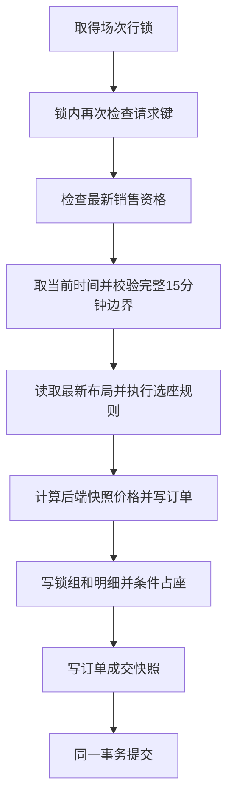

# 登录、幂等下单与整组锁座导读

本页对应第四周第一个小闭环：登录 → 手选/推荐组合下单 → 查询自己的待支付订单。实际测试及演示证据见[第四周进度](../progress/week-04.md)，运行步骤见[演示脚本](order-holds-demo.md)。支付、出票、取消与自动释放将在后续闭环实现。

## 1. 入口与身份

POST /api/auth/login 校验固定账号密码，返回不透明令牌及两小时到期时间。后续请求使用 Authorization: Bearer。BearerTokenFilter 计算摘要，查 MySQL 令牌及账号，验证过期、启用和角色，将可信身份写入认证上下文。订单 JSON 不接收 customerId 或金额。

POST /api/orders 需要消费者令牌与 Idempotency-Key，JSON 示例：

```json
{"sessionId": 1, "selectionMode": "RECOMMENDED", "seatIds": [12, 13]}
```

首次成功返回 201，重放成功返回 200，GET /api/orders/{id} 查询本人订单。响应包含订单状态/总价/支付截止、锁组与座位成交快照。Swagger 的 Authorize 输入登录返回的 token 原值，管理写请求使用 operator1，订单使用 consumer1 或 consumer2。

## 2. 一次购买的主流程

以消费者买两个座位为例，OrderService 先校验键、拒绝重复座位并排序，将场次、选座方式和座位集合计算成请求摘要。已存在同键订单时，摘要相同返回原订单，不同返回冲突。重放不执行新购买校验，因此暂停或到期后仍能找回原订单。

新请求由独立 OrderTransactionService 开启 READ COMMITTED 事务：



catalog 的 CatalogPurchaseService 负责场次锁和销售上下文；inventory 的 InventoryHoldService 负责最新布局、共用规则与占用；trade 负责订单编排和成交快照。跨模块通过服务调用，写服务用 MANDATORY 要求加入现有事务。

时间只在拿到场次锁后取一次，截到数据库微秒精度。若此刻为 10:00:00，订单和锁期限都为 10:15:00；此前等待锁的时间不扣掉这 15 分钟。新订单要求 now + 15 分钟 <= admission_close_at，相等允许。

## 3. 数据如何一起变化

两座购买成功后，新增一张 PENDING_PAYMENT 订单、两个 order_item 成交快照、一组 ACTIVE seat_hold、两个 seat_hold_item；两个 session_seat 变为 HELD 并指向同一 current_hold_id。成交价由后端 price_snapshot 求和，客户端不能改价。

订单项回答“买了什么、按什么价格成交”；锁明细回答“这组锁包括哪些座位”；库存行回答“目前被谁占用”。历史明细不因释放而删除，也不对座位 ID 建永久唯一约束。HELD 与非空当前锁的双向 CHECK、同场次复合外键提供数据库兜底；整组数量、ACTIVE 状态与一致期限由事务维护。

数据库行锁只持续这次短事务，提交后释放。15 分钟业务占用由持久化状态表达，不会让一个消费者持有整个场次的数据库锁 15 分钟。

## 4. 异常与事务边界

| 情况 | 结果 |
| --- | --- |
| 无登录/令牌失效 | 401 UNAUTHORIZED |
| 登录角色错误 | 403 FORBIDDEN |
| 订单未知或不属于当前消费者 | 404 NOT_FOUND |
| JSON 缺失/空座位/非正数、缺请求键 | 400 INVALID_REQUEST |
| 请求键格式非法 | 400 INVALID_IDEMPOTENCY_KEY |
| 重复/跨场次座位、推荐不连座 | 400 INVALID_SELECTION / NOT_ADJACENT |
| 已占座、停用票档、停售、新孤座 | 409 SEAT_NOT_AVAILABLE / PRICE_TIER_DISABLED / SESSION_NOT_ON_SALE / NEW_ORPHAN |
| 入场截止不足完整 15 分钟 | 409 ORDER_SALES_CLOSED |
| 同键改变购买内容 | 409 IDEMPOTENCY_CONFLICT |
| 锁等待超时或死锁 | 409 ORDER_RETRY_REQUIRED，保留原键与内容重试 |
| 任一插入或部分条件更新后发生异常 | 订单、锁、明细与全部库存更新一起回滚 |

同场次的两个买家按场次锁串行重验，保护不重叠座位共同制造孤座的情况。不同场次的同消费者/键不共享场次锁，因此由唯一(customer_id, idempotency_key)仲裁。OrderService 的 NOT_SUPPORTED 和独立 writer 代理保证失败事务完全回滚后，才在独立 REQUIRES_NEW 只读事务里查已提交胜者；不能在失败事务里吞掉唯一键异常继续提交。初查也走独立查询事务，避免外层事务同步保留的 MyBatis 会话缓存“原先不存在”的结果。

本人订单查询独立使用只读 REPEATABLE READ，读取同一个快照中的订单、锁与明细。新订单返回查询加入已有写事务，能读取刚写入的数据；任何返回构造异常也会使该写事务回滚。

## 5. 测试依据与代码位置

| 代码 / 测试 | 阅读重点 |
| --- | --- |
| src/main/java/com/ticketing/identity/IdentityService.java | BCrypt、随机令牌、摘要查库与期限 |
| src/main/java/com/ticketing/common/config/SecurityConfiguration.java | 白名单、角色、安全链与统一错误 |
| src/main/java/com/ticketing/trade/OrderService.java | 幂等入口、写事务外异常恢复 |
| src/main/java/com/ticketing/trade/OrderTransactionService.java | 场次锁、时间、规则、创建事务 |
| src/main/java/com/ticketing/inventory/InventoryHoldService.java | 最新布局规则与整组条件占座 |
| src/main/java/com/ticketing/inventory/InventoryHoldMapper.java | AVAILABLE/空持有者条件与影响行数 |
| src/main/resources/db/migration/V2__create_identity_orders_and_holds.sql | 六表、唯一键、复合外键与 CHECK |
| IdentityServiceTest（7项）/ IdentityIT（12项） | 密码与摘要、角色/归属、期限/停用、种子回滚 |
| OrderHoldIT（20项） | 真并发、孤座、管理竞争、跨场次唯一键、微秒截止与提交前故障 |
| InventoryHoldFailureIT（4项） | 真实部分座位/明细写入故障、持有者与外键兜底 |

并发测试用屏障与真实提交建立顺序，不能把运行耗时当作吞吐指标。跨场次同键在两边真实 INSERT 前同步，确保覆盖唯一键失败后的恢复。故障测试在真实 SQL 已写入后注入异常，断言整组回滚。

## 6. 本轮限制与学习检查

15 分钟到达只表示期限已过，当前没有自动修改锁状态或释放库存。已有订单仍可以重放且不续期。演示用新命名空间开始新购买，保留原交易事实。登录暂无刷新、注销与过期令牌清理任务；停用账号或删除令牌记录在下次验证生效。

核心代码讲解围绕三个例子：同段 1–5 两边分别买 1/2 和 4/5，为何需要在场次锁内重验；写入第一个座位后报错，为何订单与所有占用都会撤销；10:00 成功但响应丢失，10:01 重试为何仍返回原订单及 10:15 期限。负责人理解检查仍待进行，不能因代码与测试完成就视为学习验收完成。
