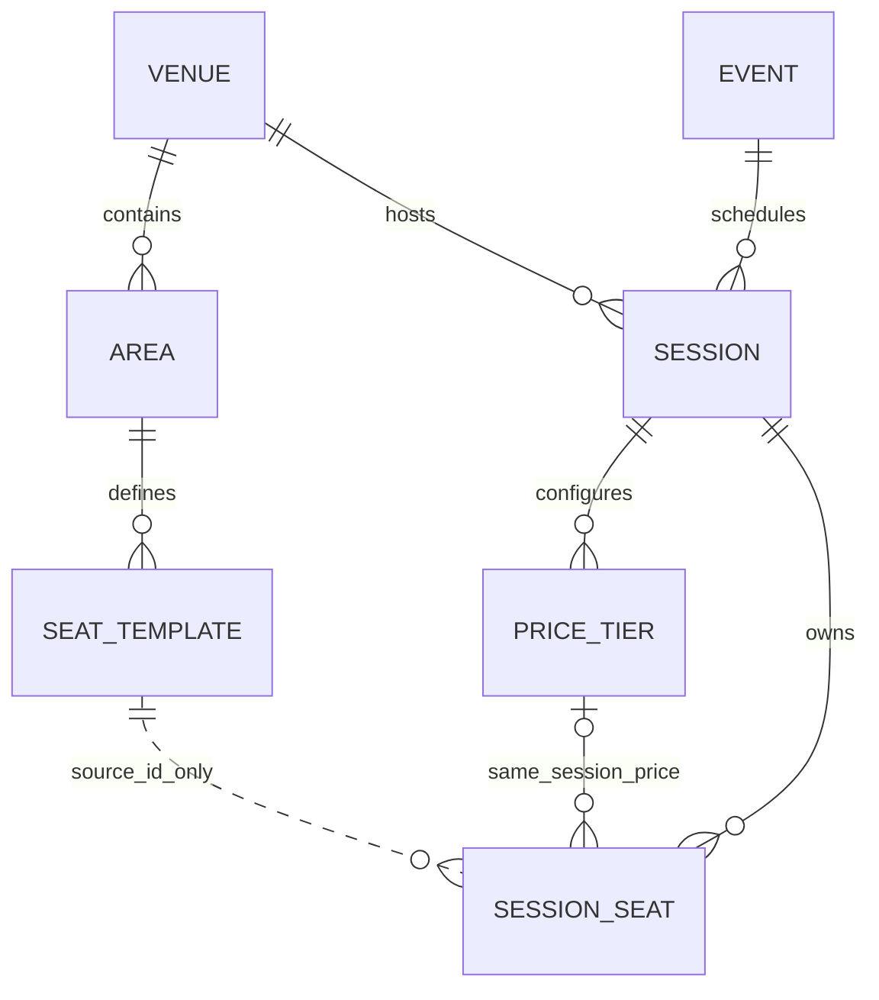

# 场馆模板与场次快照：运行、接口和代码导读

## 1. 本轮交付

七张业务表、场馆/区域/模板维护、演出创建、DRAFT 场次与票档创建、独立座位快照查询。决策见 [ADR-0005](../decisions/0005-session-seat-snapshots.md)，完整字段见[七表方案](../design/week-02-schema-review.md)。

开售、暂停、票档编辑和场次配置编辑仍未实现。数据库中存在相应状态字段，不代表已有这些行为。登录与角色校验也尚未实现（Q-05），本轮接口通过绑定本机地址的应用用于开发与演示。

## 2. 启动和重复演示

项目根目录第一个 PowerShell 窗口：

~~~powershell
.\scripts\start-infra.ps1 -IncludeTest
.\scripts\run-app.ps1
~~~

应用就绪后，第二个窗口：

~~~powershell
.\scripts\seed-week2.ps1
.\scripts\demo-snapshot.ps1
.\scripts\test.ps1 -Integration
~~~

使用其他本机端口时给 seed/demo 指定 `-BaseUrl http://127.0.0.1:<端口>`。Swagger 位于 `/swagger-ui/index.html`。

种子是规则测试厅：两个区域、五排、56 个模板座位，两个不可售位不分配票档，其余 54 位分别使用 380 元与 180 元票档。代码默认带 W2 命名空间。输出实际基准 UTC 时间及创建对象 ID，不依赖自增 ID 为 1。

本轮生成器是调用业务 API 的 PowerShell 脚本，基准时间通过 `-BaseTime` 注入，默认只读取一次系统 UTC 时间；例如 `-BaseTime '2026-10-04T02:00:00Z'`。场次在基准后 30 天开始，入场在开场前 60 分钟开放、前 5 分钟截止。同一命名空间重跑仍采用第一次保存的时间，演示的第二个场次复用该基准。Java 业务和集成测试继续使用注入的 Clock。

相同命名空间重跑会按稳定代码查找并核对已有数据，一致则复用，不刷新场次时间。完成的种子若被手工修改、缺少区域/座位或快照漂移，脚本报错并保留数据；使用 `-Namespace W2B` 可以创建另一套独立夹具。中途未完成的初始化可复用已成功创建的对象，模板批次本身整体提交。

演示脚本将池座 A 排 1 号的模板横坐标改为 777.125，验证旧场次所有快照字段不变、新场次采用新值、重复代码创建返回 409，然后在 finally 中恢复模板坐标。修改和恢复分别是独立 API 事务，恢复失败会显式报错；不会自动清空数据库。若脚本被强行终止在恢复前，按脚本记录和模板查询值恢复，或使用新命名空间，不删除已有场次。

## 3. 数据关系

实线归属关系由数据库外键约束，票档使用 `(session_id, price_tier_id)` 复合外键，不能引用其他场次票档。来源虚线没有外键；删除模板不会删除快照或清空来源号。

SQL 位于 [V1 迁移](../../src/main/resources/db/migration/V1__create_venue_catalog_inventory.sql)。已执行的版本不修改，后续结构变化新增迁移版本；不手工绕过 Flyway 建表。

## 4. 接口清单

响应外层仍为 `code/message/data/requestId`，请求编号同时在 X-Request-Id 响应头中。创建成功 201，其余成功 200。

| 方法 | 路径 | 行为 |
| --- | --- | --- |
| POST | `/api/venues` | 创建场馆，code/name/enabled 必填，address 可空 |
| GET | `/api/venues/{id}`、`/api/venues/by-code/{code}` | 查询场馆 |
| PUT | `/api/venues/{id}` | 修改 name/address/enabled，不修改稳定代码 |
| POST / GET | `/api/venues/{venueId}/areas` | 创建或列出区域 |
| PUT | `/api/areas/{id}` | 修改区域名称和展示顺序 |
| POST | `/api/areas/{areaId}/seat-templates` | 请求体为座位数组，原子批量添加；任何错误整批回滚 |
| GET | `/api/venues/{venueId}/seat-templates` | 查询物理布局，含区域信息 |
| PUT / DELETE | `/api/seat-templates/{id}` | 修改或删除模板；修改允许同场馆内换区域 |
| POST | `/api/events` | 创建演出，code/name/enabled 必填，description 可空 |
| GET | `/api/events/{id}`、`/api/events/by-code/{code}` | 查询演出 |
| POST | `/api/sessions` | 创建 DRAFT 场次、票档及全量座位快照 |
| GET | `/api/sessions/{id}`、`/api/sessions/by-code/{code}` | 查询场次与时间、名称快照 |
| GET | `/api/sessions/{id}/price-tiers` | 查询本场次票档 |
| GET | `/api/sessions/{id}/seats` | 直接查询快照，不回查物理模板 |

创建场次的请求示例（ID 必须替换为前面 API 的实际结果）：

~~~json
{
  "code": "SESSION-SAMPLE",
  "eventId": 1,
  "venueId": 1,
  "startsAt": "2027-01-15T20:00:00+08:00",
  "admissionOpenAt": "2027-01-15T19:00:00+08:00",
  "admissionCloseAt": "2027-01-15T19:55:00+08:00",
  "forbidNewOrphan": true,
  "priceTiers": [
    {"code": "TIER-A", "name": "A 档", "price": 380.00},
    {"code": "TIER-B", "name": "B 档", "price": 180.00}
  ],
  "areaPrices": [
    {"areaId": 1, "priceTierCode": "TIER-A"},
    {"areaId": 2, "priceTierCode": "TIER-B"}
  ],
  "seatOverrides": [
    {"seatTemplateId": 5, "priceTierCode": "TIER-B"}
  ]
}
~~~

区域映射是默认值，单座覆盖优先。禁用座位可以带价格但仍为 UNAVAILABLE，也可以不分配价格；需要后者时像种子脚本一样使用空区域映射，仅给可售位单座映射。遗漏任何可售位、使用其他场馆区域/座位、未知票档或重复映射均拒绝。

时间入参必须带时区，输出统一 UTC：示例中的 20:00+08:00 存为 12:00Z。金额最多两位小数且大于零。代码为至多 64 位的大写字母、数字、下划线或连字符，首字符为字母或数字。

## 5. 沿着创建入口读代码

1. [CatalogController](../../src/main/java/com/ticketing/catalog/CatalogController.java) 的 POST `/api/sessions`：接收请求，执行字段及嵌套列表校验。
2. [SessionService](../../src/main/java/com/ticketing/catalog/SessionService.java) 的 `create`：开启 REPEATABLE READ 本地事务，已有代码直接冲突；读取演出和模板，校验时间与票档映射。
3. [VenueService](../../src/main/java/com/ticketing/venue/VenueService.java) 的 `readLayout`：加入调用者事务，用普通 SELECT 读取场馆、区域、座位值，没有 FOR UPDATE。各次读取处于同一个数据库版本。
4. SessionService 插入 DRAFT 场次和票档；构造 SessionSeat 时逐字段复制区域、排、座号、坐标、过道、票档名称和金额。
5. [InventoryService](../../src/main/java/com/ticketing/inventory/InventoryService.java) 的 `createSnapshots`：强制要求已有事务，每 200 位一批 INSERT，校验最终数量；批次之间不提交。
6. 方法正常结束由 Spring 提交后 Controller 返回 ID 与数量；异常向外抛出，三类新增数据一起回滚。

例子：两个请求同时创建 SESSION-SAMPLE，都可能先查到不存在。因此应用预检查只改善正常错误响应，数据库唯一键才是最终防重复保障。冲突方不会再创建票档和快照。

模板批量维护使用同一区域行锁串行化写入，以及当前读校验排排序，保证“同一排排序相同、不同排排序不同”。这只协调模板写入者；场次创建的普通一致性读仍可并发读取旧的完整版本。移动座位按区域 ID 顺序加锁；发现来源区域已被另一个请求改变时返回 TEMPLATE_CHANGED，要求重读重试。

## 6. 数据变化和异常分支

| 情况 | 结果 |
| --- | --- |
| 正常创建 | session 增 1；price_tier 增请求票档数；session_seat 增全部模板数 |
| 模板 enabled=true 且映射完整 | 初始状态 AVAILABLE，保存票档及正数价格 |
| 模板 enabled=false | 初始状态 UNAVAILABLE，仍保存布局；允许三项价格字段全空 |
| 字段格式或嵌套参数不合法 | 400 / INVALID_REQUEST |
| 时间、映射、空布局或来源停用 | 400 / INVALID_SESSION |
| 模板排排序冲突、跨场馆移动 | 400 / INVALID_TEMPLATE |
| 不存在的场馆、演出、场次或模板 | 404 / NOT_FOUND |
| 场次代码已经存在 | 409 / SESSION_CODE_EXISTS；即使来源后来停用，也可按代码查询旧场次 |
| 其他重复代码或座位位置 | 409 / DUPLICATE_RESOURCE |
| 数据库关联冲突 | 409 / DATA_CONFLICT；内部异常细节不放入响应 |
| 中途异常或未知失败 | 本轮创建整体回滚；未知错误为 500 / INTERNAL_ERROR，日志可按 requestId 追踪 |

来源模板不含场次库存状态，模板停用不会改变已有场次座位。未提供重新生成快照的接口；同一场次、同一来源模板的唯一键继续兜底。

## 7. 测试依据与边界

- [SessionSnapshotIT](../../src/test/java/com/ticketing/catalog/SessionSnapshotIT.java)：固定 Clock，56 座夹具，布局/价格完整性、无票档不可售位、模板修改/删除隔离、错误参数无残留、写后异常回滚、顺序与双线程重复创建、数据库外键和 CHECK、模板批量原子性。
- 模板并发测试用 CountDownLatch 协调两个真实事务：创建已经建立读版本后，另一个事务同时改区域名称和坐标并提交，再继续读模板，旧创建仍读旧值，下次创建读新值。
- 回滚测试在真实库存写入后才抛异常；Spy 仅用于测试故障注入。没有给生产代码添加故障开关，也没有把该测试描述成进程中断实验。
- [Week2ApiIT](../../src/test/java/com/ticketing/catalog/Week2ApiIT.java)：真实随机端口 HTTP，验证 UTC 转换、接口响应、嵌套参数校验、重复请求与模板隔离。
- 测试清理前断言数据库名为 ticketing_test，按子表到父表清理；不执行 Flyway clean，不删除 Docker 数据卷。默认 Maven 运行没有配置测试并行。

实际执行结果及环境见[第二周进度](../progress/week-02.md)。这些是正确性证据，不是性能实验；第三周算法、销售状态迁移、锁座及交易测试尚待实现。
