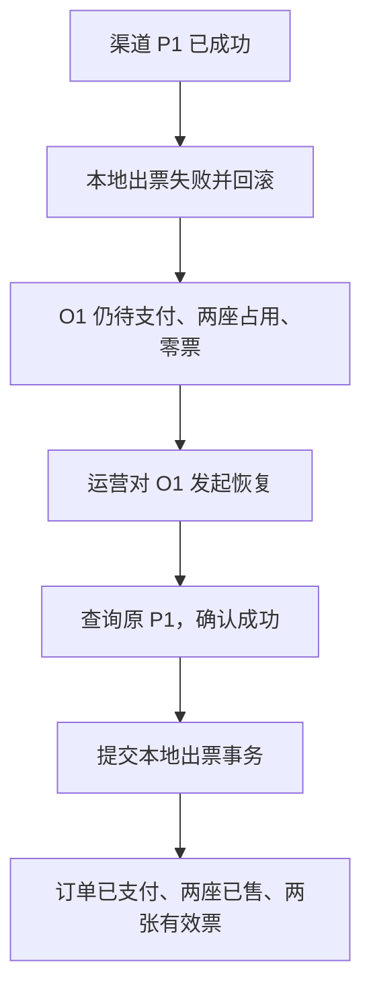

# 第四周核心业务逻辑复习笔记

整理日期：2026-10-13。依据本次对话的方案确认、代码带读和场景讨论；第四周实现依据为 `f2ea5df`，学习收尾记录为 `dccc7f7`。本笔记用于复习业务因果，接口及完整实现见[支付闭环导读](payment-loop.md)，实际验证见[第四周周报](../progress/week-04.md)。

## 1. 先确定角色、对象和时间

贯穿例子：消费者买两个座位，每座 380 元，订单 O1 共 760 元，支付截止 10:15；发起的支付编号为 P1。编号仅为教学示例。

| 名称 | 含义 | 谁负责保存或使用 |
| --- | --- | --- |
| O1 | 一次购买的订单，包含两个订单项 | 票务系统 |
| P1 | 这个订单的一次支付尝试 | 本地支付表和支付模拟器分别保存各自的记录 |
| Idempotency-Key | 识别消费者重复提交同一次支付请求 | 同订单、同请求键返回原支付 |
| T1 / T2 | 区分每次领取恢复工作的处理编号，即 token | 订单恢复记录与处理者；接管后更换 |

票务系统管理订单、座位和票；模拟器扮演收款方，保存渠道支付事实。渠道成功与本地出票完成是两个独立事实。

| 时间规则 | 用途 |
| --- | --- |
| 原订单 15 分钟支付期限 | 限制发起新支付；重试不续期 |
| 恢复任务 60 秒领取期限 | 限制谁负责本次恢复；到期后可以接管 |

支付截止后，截止前已受理的成功仍须确认并出票。时间到达不会自动证明未付款，也不会直接释放座位。

## 2. 发起支付：先保存意图，再联系渠道

入口为消费者 `POST /api/orders/{id}/payments`，携带 Idempotency-Key。消费者身份来自登录上下文，金额和原截止来自后端订单快照；他人订单不可访问。

核心编排摘自 [PaymentService.start](../../src/main/java/com/ticketing/trade/PaymentService.java#L36)：

```java
var beginning = writer.begin(customerId, orderId, key);
if (beginning.work() != null) { process(beginning.work()); }
return queries.payment(beginning.payment().paymentNumber());
```

`begin` 在本地短事务中核对归属，锁场次、订单和支付记录。原请求存在就返回原支付且不创建处理任务；新请求则要求订单待支付、无取消意图、严格早于原截止、无进行中或成功支付。

随后保存 P1、金额 760、原截止和 INITIATED，同时保存领取与恢复信息。提交后才查询渠道 P1；不存在时按原编号发起。

| 本地支付状态 | 当前可以确认什么 |
| --- | --- |
| INITIATED | 本地已保存意图，尚未确认渠道受理 |
| PROCESSING | 已同步渠道受理，最终结果尚未确定 |
| SUCCEEDED | 本地成功结果事务已提交 |

同键重放返回原记录，不自动重新调用渠道。明确失败后，截止前可使用新请求键创建新的支付尝试，仍沿用原订单截止。未决支付应恢复原编号。

首次渠道受理还会检查实际截止，避免本地检查通过后因等待跨过期限。关单可以为尚不存在的 P1 保存 CLOSED，阻止迟到发起。

## 3. 成功出票：本地结果整组提交

模拟通知与主动查单都进入 [applyChannel](../../src/main/java/com/ticketing/trade/PaymentTransactionService.java#L127)。它先核对原订单、金额、截止、受理和结果时间，再在同一个本地事务中应用成功。

| 数据 | 成功提交后的状态 |
| --- | --- |
| 本地支付 | SUCCEEDED |
| 订单 | PAID |
| 座位锁 | CONSUMED |
| 两个场次座位 | SOLD，清除当前锁持有者 |
| 每个订单项的票 | 一张 VALID 票 |

库存核对整组座位仍由本订单持有，票模块为每项签发一票。库存和出票加入上层结果事务，任一步失败，全部本地变化回滚。

例如本地支付原为 PROCESSING，第一张票插入后抛异常：事务结束后仍是本地支付处理中、订单待支付、锁 ACTIVE、两座 HELD、零票。已经独立提交的渠道 SUCCEEDED 保留。后续查询原 P1，再补齐本地结果。

事务边界是：本地保存意图并提交 → 无本地库存锁时调用独立渠道事务 → 本地结果事务提交。调用渠道期间不长期持有本地库存行锁；数据库行锁释放后，业务座位 HELD 状态仍保留。

通知接收器在本地提交后才返回，模拟器随后确认送达。出票失败不确认送达；提交后、送达确认前中断可以重投。旧 PROCESSING 通知不倒退成功，相反终态进入人工核查。

## 4. 安全取消：先确认支付不会再成功，再释放

消费者点击取消时，渠道可能已经收款，成功通知还在路上。立刻释放座位可能让别人买走已经付款的座位。

处理顺序：先持久保存取消意图，阻止新支付；事务外查询并关闭原支付；最后重新加锁，核对全部支付与整组持有者，确定安全后再取消释放。

| 查明的情况 | 处理 |
| --- | --- |
| 从未创建支付尝试 | 可以在本地事务中直接取消并释放 |
| 所有支付已确定 FAILED / CLOSED | 取消订单并整组释放 |
| 渠道已经 SUCCEEDED | 完成出票，返回已支付；继续放弃购买走后续退票 |
| 查询报错、结果未知或关闭失败 | 保留取消意图、待支付订单和占座，等待恢复 |

“请求取消”是意图，“取消成功”是最终结果。接口成功返回当前状态也可能仍待支付。取消和支付成功竞争时，以查明的支付事实决定结果；已支付订单的放弃购买属于退票流程。

关键代码：[保存取消意图](../../src/main/java/com/ticketing/trade/PaymentTransactionService.java#L69)、[安全条件与释放](../../src/main/java/com/ticketing/trade/PaymentTransactionService.java#L220)。

## 5. 恢复：继续完成原订单尚未完成的处理

完整背景：O1 已下单，两座占用；P1 在渠道成功；本地出票报错并整体回滚；用户查不到票。运营调用 `POST /api/operations/orders/{id}/recover`，查询原 P1，确认成功，再完成本地出票。



恢复也处理其他中断：渠道尚未受理时，未到期且无取消意图就按原编号补发；已到期或正在取消就关闭原编号；渠道已关闭但本地释放失败，就继续整组释放。

| 容易混淆的动作 | 含义 |
| --- | --- |
| 回滚 | 撤销本次未提交的本地事务变化 |
| 恢复 | 查明原支付事实，继续完成未结束的业务 |
| 退票 | 已支付并出票后的放弃购买与退款流程 |

## 6. 并发恢复：锁保护出票，token 保护任务结算

正常连续点击两次恢复，第一请求领取后，第二请求发现活动领取便返回当前状态。两个处理者都继续运行的典型情况，是旧任务超时被接管后又恢复运行。

成功场景仍为同一个 O1、同一个 P1，A / B 表示两个运营恢复请求：

| 时间 | 动作 |
| --- | --- |
| 第 0 秒 | A 用 T1 领取，查询卡住 |
| 第 61 秒 | 领取期限已过，B 用 T2 接管 |
| 第 62 秒 | B 查到成功，完成本地出票并提交 |
| 第 65 秒 | A 查到成功后进入结果事务，加锁重读，发现本地已成功，返回原记录 |

A 不能根据开始时的旧本地状态再次出票。如果 B 尚在结果事务中，A 等待行锁；B 提交后 A 再读最新结果。统一锁顺序、锁后重读和终态幂等共同保护结果，数据库的一订单项一票、当前占座唯一约束进一步保护数据。

领取记录在短事务中提交，渠道查询期间不持续持有数据库行锁。60 秒任务期限与本地结果事务的行锁分别承担不同职责。

| 保护目标 | 主要机制 |
| --- | --- |
| 结果不重复出票、座位不重复售卖 | 数据库锁、最新状态重验、幂等判断、库存条件更新及唯一约束 |
| 旧任务不重复计故障、不清掉新领取 | 结算前加锁核对当前 token |

可信支付结果可以进入幂等结果事务；旧处理者不能用过期 token 结算新任务的恢复记录。

## 7. 为什么旧任务迟来的报错不再加一次

换成未能查明结果的故障分支：A 查询卡住；60 秒后 B 接管，记录一次 A 超时未完成；B 查询也报错，记录第二次并结束领取；A 后来返回异常，T1 已失效，计数仍为 2。

查询报错表示没有得到支付答案，不等于渠道支付 FAILED。A 的超时已经结算过，迟来的异常仍属于同一次恢复尝试。

一次领取只结算一次，有两个收益：

- 恢复失败次数准确。否则同一次任务的超时和迟来报错可能被统计两次，过早达到人工介入阈值。
- 当前领取受到保护。`fail` 还会清领取并写下次恢复时间；旧 A 不能替新 B 结束任务，否则其他请求可能误以为无人处理而再次领取。

旧任务的异常仍可留在日志里排查。核心检查见 [fail](../../src/main/java/com/ticketing/trade/PaymentTransactionService.java#L180)：

```java
if (!Objects.equals(order.recoveryToken(), token)
        || token == null
        || order.orderStatus() != PENDING_PAYMENT) {
    return;
}
```

实际故障退避依次为 5、15、30、60、120 秒；连续故障第 6 次，或实际异常持续达到 10 分钟，转人工。正常 PROCESSING 不计故障；健康交互后清连续故障。矛盾支付事实立即转人工核查。

第四周由运营主动恢复，可以越过退避和人工标志，但不能抢尚未到期的领取；第五周普通扫描遵守退避和人工标志。人工处理也须查清事实，未知支付的座位继续占用。

## 8. 第四周交付与复习入口

第四周已经实现购票 API 闭环、安全取消、持久模拟渠道与运营恢复。2026-10-10 全量 229 项回归通过，真实 API 重放、渠道成功后应用重启再出票及 MySQL 锁座基线已执行；本次只整理文档，没有重新运行测试。

第五周接自动超时/恢复扫描、二维码和退票退款；第六周接核销。第四周的票号用于标识票记录，尚不作为二维码核销凭证。

| 代码 / 文档 | 复习重点 |
| --- | --- |
| [PaymentService](../../src/main/java/com/ticketing/trade/PaymentService.java) | 编排、原编号查单和补发、通知投递 |
| [PaymentTransactionService](../../src/main/java/com/ticketing/trade/PaymentTransactionService.java) | 意图、原子结果、取消、领取和失败结算 |
| [InventoryHoldService](../../src/main/java/com/ticketing/inventory/InventoryHoldService.java) | 整组座位归属核对与同事务消耗 / 释放 |
| [TicketService](../../src/main/java/com/ticketing/ticketing/TicketService.java) | 每订单项一票，加入结果事务 |
| [V4 迁移](../../src/main/resources/db/migration/V4__create_payments_and_tickets.sql) | 支付占用唯一、票唯一、复合外键和恢复字段 |
| [PaymentLifecycleIT](../../src/test/java/com/ticketing/trade/PaymentLifecycleIT.java) | 原子出票、重复乱序与真实回滚 |
| [PaymentRecoveryIT](../../src/test/java/com/ticketing/trade/PaymentRecoveryIT.java) | 安全取消、原编号恢复与旧任务故障计数 |
| [支付演示](payment-loop-demo.md) / [锁座基线](../benchmarks/order-holds-baseline.md) | 可重复演示、环境与实测证据 |
