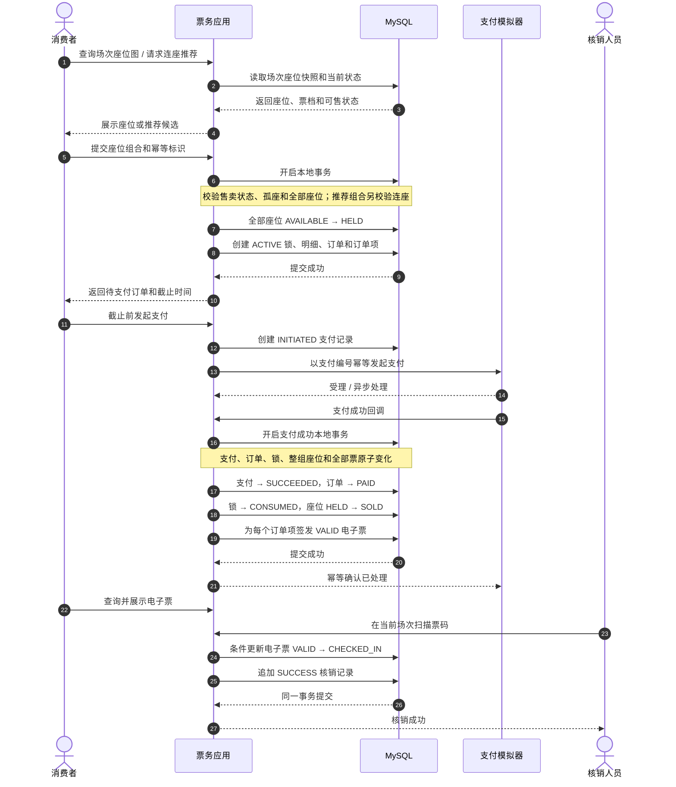
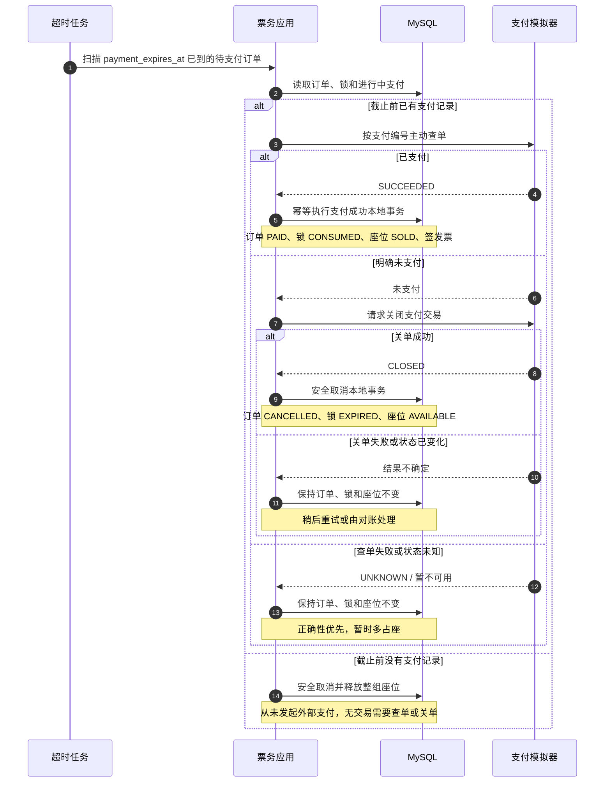
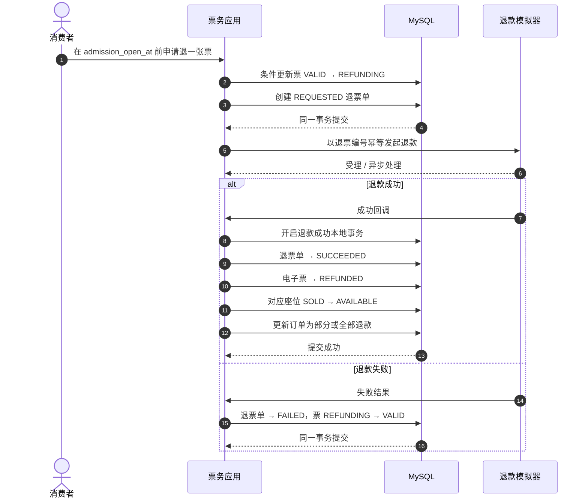
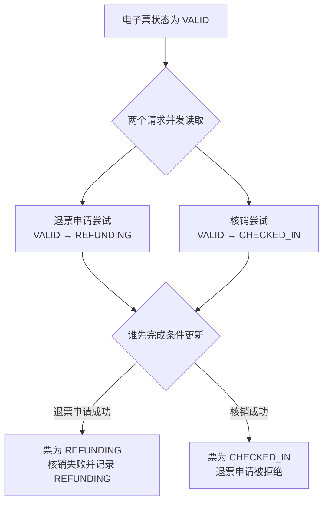
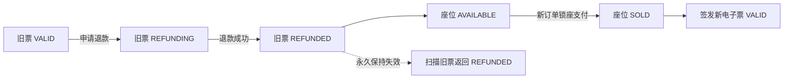
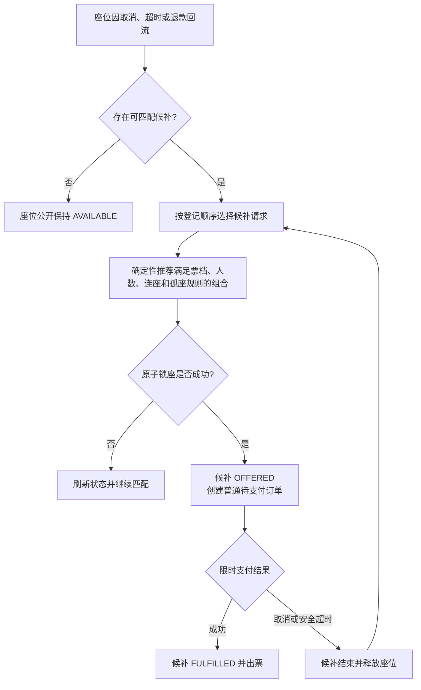

# 核心业务流程

## 1. 文档目的

本文档把核心用例、领域关系和状态迁移串成端到端流程，用于评审事务边界、外部交互和异常恢复。流程图只表达已确认的业务规则，不提前决定控制器、服务类或消息中间件的实现。

当前状态：第一周已评审版本。

## 2. 正常购票与核销



### 2.1 必须记住的边界

- 查询和推荐只是快照，不占用座位；提交时必须重新校验。
- 锁座不是先锁一个、再锁下一个，而是在一个事务中整组成功或失败。
- 调用支付模拟器不和 MySQL 事务捆绑；模拟器成功后，本地通过幂等回调或查单完成支付结果应用。
- 支付成功的本地事务必须覆盖订单、整组座位、锁和全部电子票，不能只出票一部分。
- 核销以电子票 `VALID → CHECKED_IN` 的条件更新争夺唯一成功权，核销记录保留每次尝试。

## 3. 支付截止、查单与关单



### 3.1 截止时间的三个含义

```text
payment_expires_at 到达
  → 原用户不能再发起新支付
  → 不代表座位已经释放
  → 不代表截止前已受理的支付失败
```

如果成功回调和关单同时发生，支付模拟器只能形成一个最终结果。本地无论通过回调还是主动查单观察到结果，都进入同一个幂等处理入口。

## 4. 单票退票与座位回流



退票截止只限制发起新申请。开放前已受理的退票即使在 `admission_open_at` 之后收到结果，也必须继续处理。若退款失败后已经进入入场时间，票恢复 `VALID` 并可在时间窗口内核销，但不能再次申请退票。

## 5. 退票申请与核销竞争



第六周真实实现统一先取得场次写锁，再锁订单及所需座位/票，锁后重新取时间。新退票要求 `now < open`，核销要求 `open <= now < close`，两者的合法受理窗口互斥；跨开放边界的锁等待测试检查各自实际获得锁时的资格。开放前已受理的退款继续处理，核销则看到 REFUNDING / REFUNDED 并追加拒绝审计。不要把图中的并发读取理解为同一业务时刻两个操作都具备成功资格。

胜负不由“哪个接口先查询”决定，而由谁先成功执行带当前状态条件的更新决定。最终不能同时存在成功退票和成功核销，但核销失败尝试仍需要留痕。

## 6. 退款回流后的重新销售



场次座位可以被重新出售，电子票不复活。历史上同一个场次座位可以对应多张电子票，但同一时刻最多一张有效票。

## 7. 候补匹配（条件增强）



候补复用普通订单和支付流程。具体采用回流事件触发还是定时扫描，属于实现前仍需比较的方案，不由本图决定。

## 8. 流程与文档追踪

| 流程 | 主要状态 | 主要测试场景 |
| --- | --- | --- |
| 正常锁座支付 | `AVAILABLE → HELD → SOLD`、`PENDING_PAYMENT → PAID` | SCN-04 至 SCN-15 |
| 支付超时 | `ACTIVE → EXPIRED`、`PENDING_PAYMENT → CANCELLED` | SCN-11 至 SCN-16、SCN-27 |
| 单票退票 | `VALID → REFUNDING → REFUNDED/VALID` | SCN-17 至 SCN-22 |
| 在线核销 | `VALID → CHECKED_IN` | SCN-19、SCN-23 至 SCN-25 |
| 候补匹配 | `WAITING → OFFERED → FULFILLED/EXPIRED` | SCN-28 至 SCN-31 |

## 9. 下一步

使用这些流程和测试场景完成第一周剩余产出：整理一份状态迁移与不变量评审摘要、初始化 Git 仓库，并定义固定虚拟场馆的种子数据草图。数据库表结构和 Spring Boot 工程骨架在这些内容完成后进入第二周。
