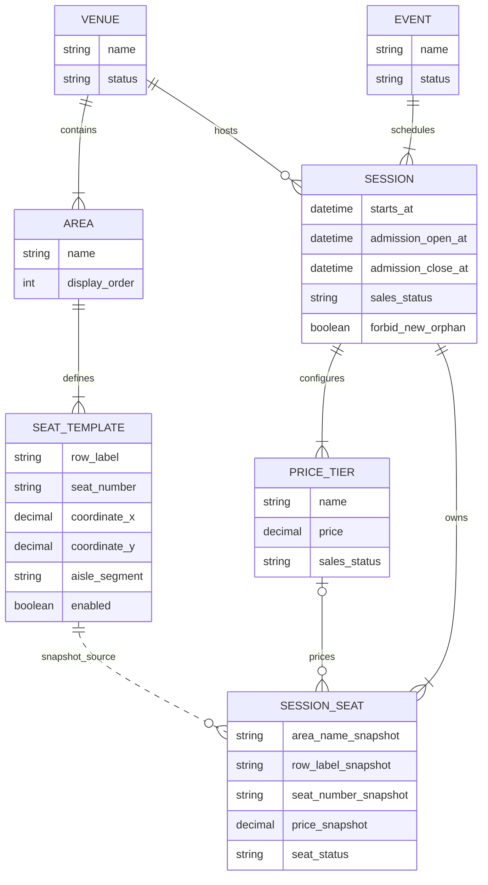
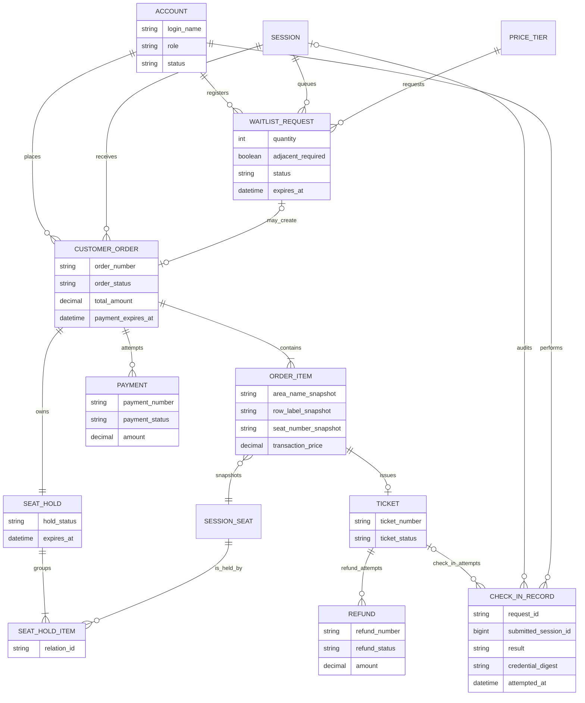

# 核心领域关系模型

## 1. 文档目的

本文档描述 MVP 业务对象、对象职责和对象之间的关系，用于后续状态机、数据库模型和模块边界设计。

当前状态：第一周已评审版本。图中的对象不等于最终数据库表，关系也不代表已经选定外键、索引或事务实现。候补相关对象属于条件增强，其余对象属于核心闭环。

第二周场馆与场次七表的具体结构已确认并实现，见 [ADR-0005](../decisions/0005-session-seat-snapshots.md) 与[快照导读](../development/session-snapshots.md)。本图继续表达领域关系；来源模板虚线不建立数据库外键。

第四周首个闭环已确认账号、订单/明细、锁/明细及场次座位当前持有者结构，见 [ADR-0012](../decisions/0012-order-hold-schema-and-transaction.md)，由 V2 实现。第四周后续已通过 V3 / V4 实现独立模拟支付、本地支付与最小电子票记录，见 [ADR-0014](../decisions/0014-persist-independent-payment-simulator.md) / [ADR-0015](../decisions/0015-local-payment-ticket-cancellation-recovery.md)。第五周已实现按需 HMAC 凭证、本人文本/PNG 查询，以及 V5 单票退票、独立模拟退款/通知和持久恢复，见 [ADR-0018](../decisions/0018-single-ticket-refunds-and-durable-recovery.md)。第六周通过 V6 增加正式核销与审计，报告诊断包不新增业务表，见 ADR-0019 / 0020。候补仍未实现，实际验证见各周周报。

第一周曾列出 ticket.credential_digest 概念候选，实际 V4 票表没有该字段。Q-07 已确认按需生成 HMAC 凭证，不新增凭证持久化字段，见 [ADR-0017](../decisions/0017-hmac-ticket-credentials.md)；下图移除这一未落地候选。

## 2. 为什么拆成两张图

整个模型围绕两条生命周期展开：

1. 场馆中的物理座位，如何在某个场次创建时变成可售卖的场次座位快照。
2. 场次座位，如何经过锁定、下单、支付、出票、退票和核销完成交易与履约。

第一条主要解决“历史不能被模板修改污染”，第二条主要解决“多个独立状态在竞争中仍保持一致”。

## 3. 场馆、演出与场次



### 3.1 关系解释

| 关系 | 业务含义 |
| --- | --- |
| 场馆 1 → N 区域 | 一个场馆由多个看台、楼层或价格区域组成；区域只属于一个场馆。 |
| 区域 1 → N 座位模板 | 座位模板描述物理座位的位置、排号、座号和过道分段。 |
| 演出 1 → N 场次 | 同一演出可以在不同时间安排多个场次；一个场次只属于一个演出。 |
| 场馆 1 → N 场次 | 一个场馆可以承载多个场次；一个场次只在一个场馆履约。 |
| 场次 1 → N 票档 | 票档是场次内的定价规则，不作为所有场次共用的实时价格。 |
| 场次 1 → N 场次座位 | 场次座位是实际参与查询、锁定和售卖的库存单元。 |
| 座位模板 1 → N 场次座位 | 每次创建场次时复制模板信息。图中虚线只表达来源追踪，不表示场次座位继续实时依赖模板。 |
| 票档 0..1 → N 场次座位 | 一个票档可以分配给多个场次座位；每个可售场次座位必须对应一个票档和创建时的价格快照，不可售座位可以暂不分配票档。 |

### 3.2 模板与快照边界

创建场次时，从座位模板复制至少以下信息到场次座位：区域名称或标识、排、座号、坐标、过道分段、可售性、票档和价格。之后修改或停用座位模板，不修改已经生成的场次座位。

保留来源模板标识的作用是追踪“这张快照从哪里生成”，而不是在展示或售卖时回查模板。V1 已确认来源模板标识不建外键，避免模板后续维护影响历史快照。

## 4. 交易、票务与履约



### 4.1 主购买链路

```text
消费者账号
  → 订单
    → 多个订单项
      → 每个订单项对应一个场次座位
      → 支付成功后，每个订单项最多签发一张电子票
```

订单表达一次购买行为，订单项表达其中一张座位票。座位名称、票档和成交价格保存在订单项快照中，因此历史订单不依赖之后可能变化的场次配置。

订单状态描述整笔购买的总体结果；电子票状态描述单张票是否有效、核销或退票。支持单票退票后，同一订单中的电子票可以处于不同状态，所以两者不能合并。

### 4.2 锁座关系

建议使用“座位锁 + 锁座明细”表达一次整体锁定：

```text
一张订单 → 一组座位锁 → 多条锁座明细 → 多个场次座位
```

`Seat Hold` 表达整组锁定的状态和过期时间，`Seat Hold Item` 只表达组内包含哪个座位，不拥有独立业务状态。这样可以记录历史上不同订单对同一场次座位的先后锁定，又不会在模型上允许一组锁座出现部分有效、部分失效。

首版中锁座与待支付订单在同一个业务操作内创建，一张订单拥有一组锁座。支付成功、取消或超时后保留锁座记录用于审计，只改变其状态，不删除历史记录。

当前占用由场次座位的 seat_status 与 current_hold_id 表达，HELD 必须指向同场次锁。锁明细保留历史关联，不对座位 ID 建永久唯一约束；创建事务保证订单项、锁明细与当前持有者一致。数据库外键并不能单独证明整组锁均为 ACTIVE 或期限一致。

### 4.3 支付关系

建议一个订单允许关联多条支付记录，每条记录代表一次向支付模拟器发起的支付交易，以保留失败后的再次支付尝试。针对同一外部支付交易的重复回调、主动查单和关单都作用于同一条支付记录，不能被误认为新的支付尝试；是否另外保存每次交互的审计日志，在支付模块详细设计时决定。

不变量不是“一张订单只能有一条支付记录”，而是：一张订单最多只能确认一笔有效成功支付，重复结果不能重复出票。订单支付截止后不能创建新的支付记录，截止前已经受理的支付仍可以继续确认。

### 4.4 电子票、退票与核销

- 一个订单项最多签发一张电子票；未支付订单项没有电子票。
- 一张电子票可以保留多次退票处理记录，但同一时刻最多有一笔有效的退票流程，且最多成功一次。
- 一张电子票可以对应多次核销尝试，但最多一次成功。
- 核销记录中的电子票关系允许为空，因为伪造或无法识别的票码也必须留下审计记录。此时记录提交凭证的安全摘要、当前场次、结果和失败原因，不能因为找不到电子票而丢弃记录。
- 退票成功、电子票失效和场次座位回流在同一个本地事务内完成；回流后重新售出会产生新的订单项和电子票，旧票不恢复。

### 4.5 候补关系（条件增强）

消费者可以为一个场次的一个票档登记多个座位的候补请求。请求只保存人数和连座偏好，不提前绑定场次座位。

匹配成功后，候补请求最多创建一张普通待支付订单。之后复用普通订单的锁座、支付、超时和出票关系；候补不建立另一套订单或票务模型。未匹配或已过期的候补请求没有订单。

## 5. 核心对象职责

| 对象 | 负责表达 | 不负责表达 |
| --- | --- | --- |
| 座位模板 | 场馆物理布局和默认可用性 | 某场次是否已锁定或售出 |
| 场次座位 | 某场次中的库存身份、快照和销售状态 | 订单是否支付、票是否核销 |
| 座位锁 | 一组座位的临时占用及期限 | 最终成交价格、支付结果 |
| 订单 | 一次购买行为的总体状态和金额 | 每张票各自的履约状态 |
| 订单项 | 单个座位及成交信息的历史快照 | 支付渠道交互历史 |
| 支付记录 | 一次支付交易及查单、关单和回调结果 | 座位当前状态 |
| 电子票 | 一个订单项的入场资格和票状态 | 退款过程和每次核销尝试的历史 |
| 退票单 | 一张电子票的一次退款流程 | 订单中其他电子票的状态 |
| 核销记录 | 每一次核销尝试及其结果 | 作为电子票当前状态的替代品 |
| 候补请求 | 尚未绑定座位的购票意愿和队列状态 | 提前占用座位或保存支付资金 |

## 6. 从关系得到的关键不变量

1. 一个场次座位在同一时刻最多出现在一条有效锁座明细中。
2. 一组锁座的全部明细必须整体生效或整体失败。
3. 一个订单项只对应一个场次座位，并保存当时的座位和价格快照。
4. 一个订单项最多签发一张电子票。
5. 一个场次座位同一时刻最多对应一张有效电子票，但退票回流并重新售出后可以存在多张历史电子票。
6. 一张订单最多只能确认一笔成功支付。
7. 一张电子票最多成功退票一次、最多成功核销一次，且两者不能同时成功。
8. 所有核销尝试都必须留痕，即使票码无法关联到电子票。
9. 一个候补请求最多创建一张待支付订单，不提前绑定场次座位。

## 7. 已确认的建模决策

以下五项已由项目负责人确认：

1. **锁座使用主从结构**：一条 `Seat Hold` 代表整组锁定，多条 `Seat Hold Item` 分别关联场次座位，而不是每个座位各自成为互不相关的锁。
2. **订单允许多条支付记录**：用于表达失败重试和不同支付尝试，但业务约束最多一笔成功支付。
3. **电子票允许多条退票记录**：保留失败和重试历史，但同一时刻最多一笔有效退票，且最多成功一次。
4. **核销记录可以不关联电子票**：无法识别或伪造票码也保存核销记录，通过凭证摘要审计，不保存原始敏感票码。
5. **只有可售座位强制分配票档**：可售场次座位必须有票档和价格快照；因视线遮挡、维修等原因不可售的座位可以保留在座位图快照中但不分配票档，重新启用前必须完成票档配置。

## 8. 下一步

分别为场次座位、座位锁、订单、支付、电子票、退票、候补和核销定义状态迁移表，并为每条迁移补充正常触发、拒绝条件和竞争场景。
