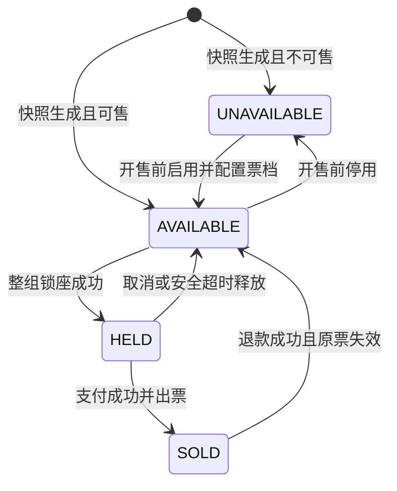
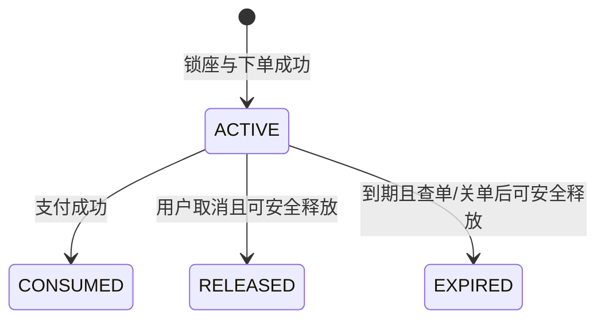
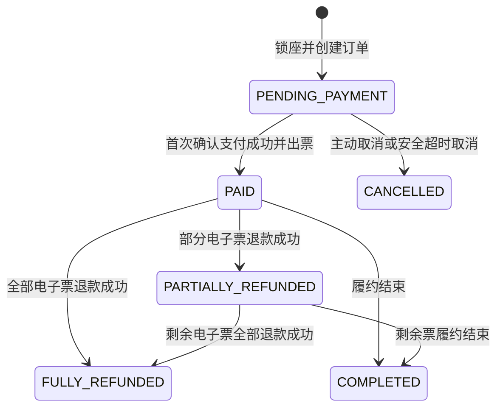
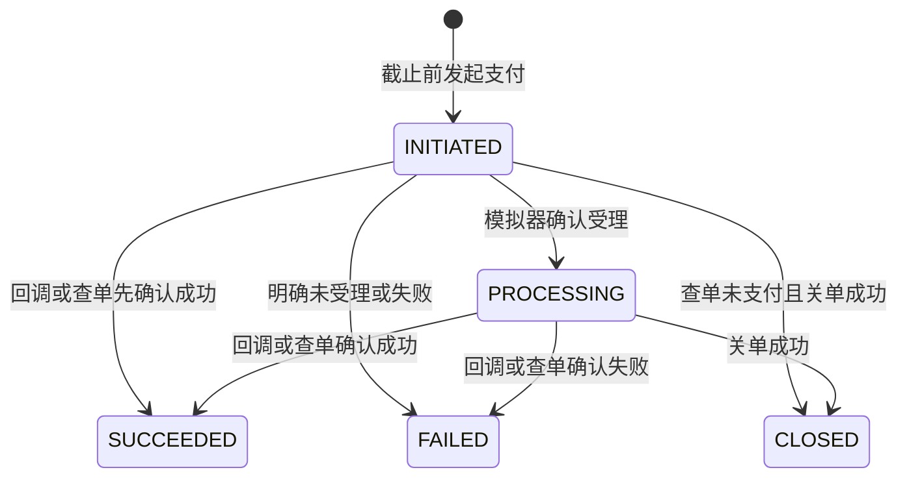
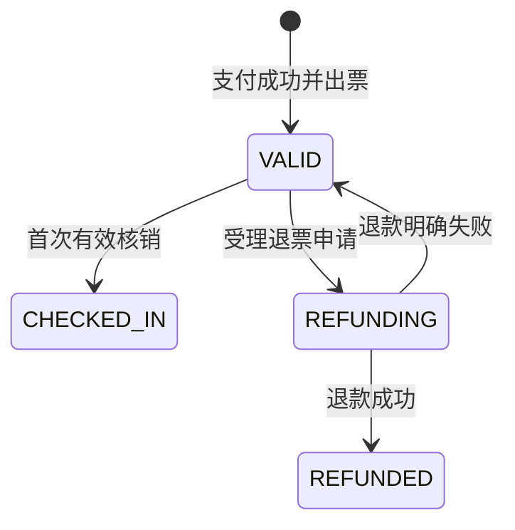
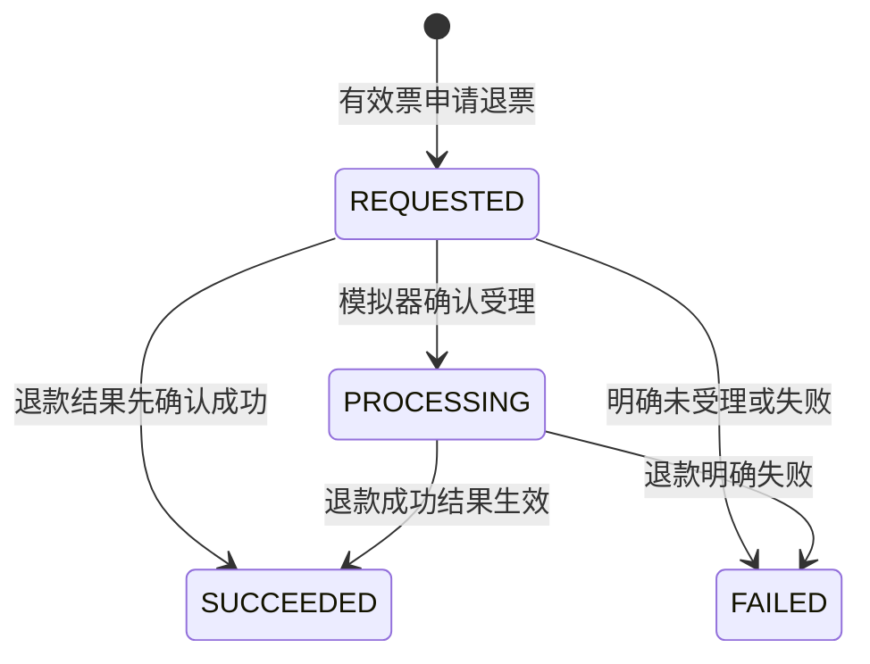
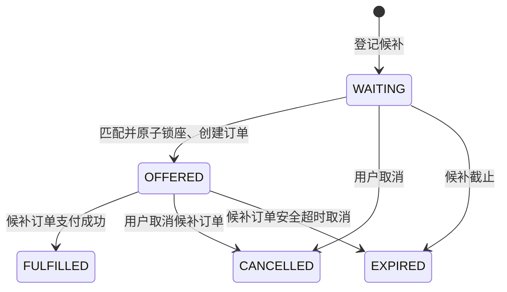

# 核心状态迁移

## 1. 文档目的

本文档定义核心对象有哪些业务状态、什么事件可以改变状态、什么情况下必须拒绝，以及状态竞争时需要保持哪些结果。

当前状态：第一周已评审版本。状态名使用英文候选值，便于后续映射到代码枚举；本轮确认的是业务语义，不代表已经决定数据库更新语句或并发控制实现。

销售管理状态与并发控制见下节及 [ADR-0006](../decisions/0006-serialize-session-management.md)。第四周已实现锁座、支付、出票、安全取消及释放；第五周接入自动超时/恢复扫描及本人 HMAC 票码文本/PNG 查询，规则见 ADR-0016 / 0017，执行证据见相应周报。取码不改变票状态；退票和正式核销尚未实现。

## 2. 状态设计原则

1. 状态只描述一个对象自身的生命周期，不用订单状态代替支付、座位、票或退票状态。
2. 时间到达本身不会神奇地修改数据。定时任务必须执行满足条件的状态迁移，失败后可以重试。
3. 每次迁移都要检查“当前状态仍然是预期状态”，重复执行只能得到相同结果或明确拒绝。
4. 多对象同时变化时，需要明确事务边界；首版在同一个 MySQL 本地事务内完成能够同步完成的变化。
5. 状态历史和当前状态用途不同。当前状态用于业务判断，支付记录、退票单和核销记录用于保留过程与审计。

### 2.1 场次销售状态（第二周已实现）

| 起始状态 | 目标状态 | 规则 |
| --- | --- | --- |
| DRAFT | ON_SALE | 至少有一个 AVAILABLE 且票档启用的座位；首次写 first_opened_at |
| ON_SALE | STOPPED | 暂停新销售，不修改座位快照或已有交易 |
| STOPPED | ON_SALE | 重新检查可售座位与票档开关，保留 first_opened_at |

重复设置当前 ON_SALE/STOPPED 无副作用成功；不能退回 DRAFT，也不能从 DRAFT 直接暂停。first_opened_at 非空时场次配置永久冻结，暂停不解除冻结；票档启停是独立的销售开关，不改变座位库存状态。配置、销售状态和票档开关写入在同一本地事务中先锁场次行，再读取最新状态。第二周证据见该周周报；第四周已验证消费者下单与暂停/停用票档的先后竞争，已有订单和锁不会被这些销售开关清除。

## 3. 场次座位状态

### 3.1 状态定义

| 状态 | 含义 | 是否允许新锁座 |
| --- | --- | --- |
| `UNAVAILABLE` | 本场次暂不销售该座位，例如模板默认禁用、视线遮挡或未配置票档 | 否 |
| `AVAILABLE` | 当前可以参与推荐和锁座 | 是 |
| `HELD` | 已被一组有效座位锁临时占用 | 否 |
| `SOLD` | 已确认支付并签发有效或后续已履约的电子票 | 否 |

### 3.2 状态图

### 3.3 迁移规则

| 起始状态 | 目标状态 | 触发事件 | 同一事务内必须完成 | 必须拒绝的情况 |
| --- | --- | --- | --- | --- |
| `UNAVAILABLE` | `AVAILABLE` | 运营人员在开售前启用 | 校验并保存票档、价格和可售配置 | 已开售；没有票档或价格 |
| `AVAILABLE` | `UNAVAILABLE` | 运营人员在开售前停用 | 更新座位可售配置 | 已开售；座位已锁定或售出 |
| `AVAILABLE` | `HELD` | 普通购买或候补匹配锁座 | 创建整组座位锁、全部锁座明细、待支付订单和订单项 | 任一座位状态已变化；孤座规则失败；推荐组合或要求连座的候补不满足连座 |
| `HELD` | `AVAILABLE` | 用户取消，或订单到期后确认未支付且关单成功 | 结束座位锁并取消订单 | 支付已成功；支付状态未知；锁不属于该订单 |
| `HELD` | `SOLD` | 支付成功结果首次生效 | 确认订单支付成功、结束座位锁、签发全部电子票 | 订单已取消；座位锁不再有效；重复成功结果 |
| `SOLD` | `AVAILABLE` | 单票退款成功结果首次生效 | 退票单成功、原电子票失效、座位回流 | 票已核销；退款未成功；当前有效票不属于该座位 |

`SOLD` 不因电子票核销而改变。核销改变的是入场资格，不改变该座位已经售出的事实。

## 4. 座位锁状态

### 4.1 状态定义

| 状态 | 含义 |
| --- | --- |
| `ACTIVE` | 整组座位仍由订单占用，不能提供给其他订单 |
| `CONSUMED` | 支付成功，锁的使命完成，座位已转为已售 |
| `RELEASED` | 用户主动取消后释放 |
| `EXPIRED` | 超过支付期限并安全确认未支付后释放 |

### 4.2 状态图

### 4.3 关键边界

- `expires_at` 到达只会终止用户发起新支付的资格，不会自动把 `ACTIVE` 改成 `EXPIRED`。
- 截止前已有支付正在确认且结果未知时，锁可以在 `expires_at` 之后继续保持 `ACTIVE`。
- 一组锁的明细不拥有独立业务状态，整组只能一起生效、消费或释放。
- `CONSUMED`、`RELEASED` 和 `EXPIRED` 都是终态，历史记录不删除。

## 5. 订单状态

### 5.1 状态定义

| 状态 | 含义 |
| --- | --- |
| `PENDING_PAYMENT` | 已锁座并创建订单，尚未确认成功支付 |
| `PAID` | 已确认支付并完成首次出票，尚未发生成功退票 |
| `PARTIALLY_REFUNDED` | 至少一张票已成功退票，仍有未退票的票 |
| `FULLY_REFUNDED` | 所有电子票均已成功退票 |
| `COMPLETED` | 订单履约已经结束，不再可能发生核销或退票 |
| `CANCELLED` | 未支付订单已安全取消并释放锁座 |

### 5.2 状态图

### 5.3 迁移规则

| 起始状态 | 目标状态 | 触发事件 | 关键条件 |
| --- | --- | --- | --- |
| `PENDING_PAYMENT` | `PAID` | 支付成功结果首次生效 | 整组锁仍有效；订单未取消；所有订单项均成功出票 |
| `PENDING_PAYMENT` | `CANCELLED` | 用户取消 | 没有成功支付；没有结果未知的进行中支付，或相关支付已安全关单 |
| `PENDING_PAYMENT` | `CANCELLED` | 超时任务取消 | 已超过截止时间；确认未支付且关单成功 |
| `PAID` | `PARTIALLY_REFUNDED` | 一张或部分票退款成功 | 仍有至少一张票未退款 |
| `PAID` | `FULLY_REFUNDED` | 全部票退款成功 | 所有电子票均为 `REFUNDED` |
| `PARTIALLY_REFUNDED` | `FULLY_REFUNDED` | 剩余票退款成功 | 所有电子票均为 `REFUNDED` |
| `PAID` / `PARTIALLY_REFUNDED` | `COMPLETED` | 履约结束 | 所有未退票电子票已核销，或入场截止时间已过；不存在进行中的退票 |

订单状态是订单内电子票状态的汇总，但不能代替电子票状态。`PARTIALLY_REFUNDED` 只在退款成功后出现，电子票处于 `REFUNDING` 时订单仍保持原状态。

2026-10-08 补充已确认的创建边界：新订单须同时满足销售资格与取得场次写锁后的 `now + 15 分钟 <= admission_close_at`，相等时允许，支付期限仍为完整 15 分钟，见 [ADR-0011](../decisions/0011-order-cutoff-before-admission-closes.md)。按消费者与请求编号重放已创建订单只返回原状态和原期限，不再次进入创建迁移或续锁；同编号内容冲突拒绝，见 [ADR-0010](../decisions/0010-idempotent-order-creation.md)。锁座、支付、取消和释放的实际执行证据见第四周周报；自动触发与资格重验见第五周周报。

## 6. 支付状态

### 6.1 状态定义

| 状态 | 含义 |
| --- | --- |
| `INITIATED` | 本地已创建支付记录，尚未确认支付模拟器是否受理 |
| `PROCESSING` | 支付模拟器已受理，最终支付结果尚未确定 |
| `SUCCEEDED` | 支付交易成功，成功结果已经或等待幂等应用到订单 |
| `FAILED` | 支付明确失败，本次支付尝试结束 |
| `CLOSED` | 未支付交易已成功关闭，此后不能再成功 |

### 6.2 状态图

### 6.3 关键规则

- 一个订单可以有多条历史支付记录，但同一时刻最多一条 `INITIATED` 或 `PROCESSING` 的支付记录。
- 只有订单为 `PENDING_PAYMENT` 且当前时间早于 `payment_expires_at` 时，才能创建新的支付记录。
- 一次失败支付不会自动取消订单。截止时间前，消费者可以在前一笔支付已经明确失败后重新发起。
- 同一个支付交易的回调、查单和关单都使用同一支付编号和幂等入口，不创建新的支付记录。
- 最终结果可能先于“受理成功”的本地更新到达，因此结果处理入口必须接受 `INITIATED` 或 `PROCESSING`，不能依赖固定到达顺序。
- `SUCCEEDED`、`FAILED` 和 `CLOSED` 是支付终态，不允许被迟到事件改写。
- 关单和支付成功并发时，支付模拟器必须只允许一个终态成立；本地按查询到的最终结果推进订单。
- 如果支付模拟器暂时不可用或结果未知，支付保持 `INITIATED` 或 `PROCESSING`，订单和锁座不释放，等待重试与对账。

## 7. 电子票与退票状态

### 7.1 电子票状态

| 状态 | 含义 | 是否允许核销 | 是否允许申请退票 |
| --- | --- | --- | --- |
| `VALID` | 已出票且当前有效 | 是，需同时满足场次和时间窗口 | 仅当 `now < admission_open_at` |
| `REFUNDING` | 已受理退票，等待模拟退款结果 | 否 | 否 |
| `REFUNDED` | 退款成功，票永久失效 | 否 | 否 |
| `CHECKED_IN` | 已成功核销 | 否 | 否 |

`VALID` 只表示电子票没有被核销或退票失效，不表示任何时间都允许入场。一次核销仍必须同时满足票码真实性、当前场次和 `admission_open_at <= now < admission_close_at`。

### 7.2 退票单状态

| 状态 | 含义 |
| --- | --- |
| `REQUESTED` | 已创建退票单，等待提交模拟退款 |
| `PROCESSING` | 模拟器已受理，退款结果尚未确定 |
| `SUCCEEDED` | 退款成功并已在本地完成票失效和座位回流 |
| `FAILED` | 退款明确失败，本次退票流程结束 |

### 7.3 事务与竞争规则

- 受理退票时，在同一事务中创建 `REQUESTED` 退票单，并将票从 `VALID` 改为 `REFUNDING`。因此核销与退票申请并发时，只有一个条件更新可以成功。
- 只有 `now < admission_open_at` 时才能受理新退票；到达开放时刻后拒绝。开放前已经进入 `REFUNDING` 的流程继续处理，不因时间越过边界而中断。
- 退款最终结果可能先于“受理成功”的本地更新到达，因此结果处理入口接受 `REQUESTED` 或 `PROCESSING`，不能依赖固定回调顺序。
- 退款成功时，在同一事务中把退票单改为 `SUCCEEDED`、电子票改为 `REFUNDED`、场次座位从 `SOLD` 改为 `AVAILABLE`，并更新订单汇总状态。
- 退款明确失败时，在同一事务中把退票单改为 `FAILED`，并把电子票从 `REFUNDING` 恢复为 `VALID`。消费者可以重新申请并产生新的退票单。
- `CHECKED_IN` 和 `REFUNDED` 都是电子票终态，旧票不能恢复，也不能因为座位重新售出而重新有效。
- 同一张票同时最多有一张 `REQUESTED` 或 `PROCESSING` 的退票单，最多一张 `SUCCEEDED` 退票单。

## 8. 候补状态（条件增强）

### 8.1 状态定义

| 状态 | 含义 |
| --- | --- |
| `WAITING` | 正在队列中等待满足条件的座位 |
| `OFFERED` | 已自动分配并锁座，已创建限时支付订单 |
| `FULFILLED` | 候补订单支付成功并出票 |
| `CANCELLED` | 用户主动取消候补或候补订单 |
| `EXPIRED` | 候补截止，或匹配后的支付机会超时 |

### 8.2 关键规则

- 从 `WAITING` 到 `OFFERED` 时，候补状态、整组锁座、待支付订单和订单项在同一个本地事务内创建，不保留长期 `MATCHING` 中间状态。
- 候补匹配任务重复执行时，同一个候补请求最多创建一张订单。
- `OFFERED` 的购买机会取消或超时后，该候补请求结束，不自动返回队尾，也不重新进入 `WAITING`。
- 候补订单复用普通订单、支付、锁座和出票状态机，不建立另一套交易状态。
- `FULFILLED`、`CANCELLED` 和 `EXPIRED` 是终态。

## 9. 核销结果（不可变记录）

核销记录不是一个等待后续迁移的业务对象。每次扫描完成后直接追加一条不可变结果，不更新或覆盖之前的记录。

| 结果 | 含义 | 是否改变电子票状态 |
| --- | --- | --- |
| `SUCCESS` | 票、场次、时间窗口和状态均有效，本次首次核销成功 | `VALID → CHECKED_IN` |
| `INVALID_CREDENTIAL` | 票码无法验证或无法关联电子票 | 否 |
| `WRONG_SESSION` | 电子票不属于核销人员当前选择的场次 | 否 |
| `TOO_EARLY` | 当前时间早于 `admission_open_at` | 否 |
| `TOO_LATE` | 当前时间不早于 `admission_close_at` | 否 |
| `ALREADY_CHECKED_IN` | 电子票已经成功核销 | 否 |
| `REFUNDING` | 电子票正在退款，入场资格暂停 | 否 |
| `REFUNDED` | 电子票已经退款并永久失效 | 否 |

核销 `SUCCESS` 必须通过 `VALID → CHECKED_IN` 的条件更新取得唯一成功权。两个入口并发扫描时，一个成功，另一个记录为 `ALREADY_CHECKED_IN`；两次尝试都保留。

## 10. 跨对象原子变化

| 业务事件 | 同一 MySQL 事务内的变化 |
| --- | --- |
| 锁座下单 | 全部场次座位 `AVAILABLE → HELD`；创建一组 `ACTIVE` 锁及明细；创建 `PENDING_PAYMENT` 订单和订单项 |
| 支付成功 | 支付 `→ SUCCEEDED`；订单 `PENDING_PAYMENT → PAID`；锁 `ACTIVE → CONSUMED`；全部座位 `HELD → SOLD`；为全部订单项签发 `VALID` 电子票 |
| 用户取消 | 订单 `PENDING_PAYMENT → CANCELLED`；锁 `ACTIVE → RELEASED`；全部座位 `HELD → AVAILABLE` |
| 安全超时 | 订单 `PENDING_PAYMENT → CANCELLED`；锁 `ACTIVE → EXPIRED`；全部座位 `HELD → AVAILABLE` |
| 受理退票 | 创建 `REQUESTED` 退票单；电子票 `VALID → REFUNDING` |
| 退款成功 | 退票单 `REQUESTED/PROCESSING → SUCCEEDED`；电子票 `REFUNDING → REFUNDED`；座位 `SOLD → AVAILABLE`；更新订单退款汇总状态 |
| 退款失败 | 退票单 `→ FAILED`；电子票 `REFUNDING → VALID` |
| 核销成功 | 电子票 `VALID → CHECKED_IN`；追加 `SUCCESS` 核销记录 |
| 候补匹配 | 候补 `WAITING → OFFERED`；创建普通锁座、订单和订单项；全部匹配座位 `AVAILABLE → HELD` |

支付模拟器的受理、查单、关单和退款模拟属于外部交互，即使当前实现位于同一应用，也不能假装与本地数据库提交天然处于一个事务。调用失败或进程中断后依靠幂等请求、状态重试和对账恢复。

## 11. 每个关键迁移的最低测试

| 迁移 | 最低自动化测试 |
| --- | --- |
| `AVAILABLE → HELD` | 正常整组锁座；重叠座位并发只能一个成功；任一失败时整组回滚 |
| `HELD → AVAILABLE` | 主动取消；重复取消；支付未知时拒绝释放；任务重复执行不误释放 |
| `HELD → SOLD` | 正常支付出票；重复成功回调；支付成功与取消/超时竞争 |
| `SOLD → AVAILABLE` | 正常退款回流；旧票保持失效；回流后新订单签发新票 |
| `PENDING_PAYMENT → CANCELLED` | 未支付取消；到期查单关单；迟到成功与关单竞争 |
| `VALID → CHECKED_IN` | 正常核销；重复核销；双入口并发核销；错误场次和时间窗口 |
| `VALID → REFUNDING` | 正常申请；重复申请；与核销并发只能一个成功 |
| `REFUNDING → REFUNDED` | 重复退款成功结果；票失效和座位回流原子完成 |
| `REFUNDING → VALID` | 退款失败后恢复；恢复后可重新申请或核销 |
| `WAITING → OFFERED` | 先到先得；匹配任务重复；与普通购买竞争；整组匹配失败回滚 |

## 12. 已确认的业务规则

1. **未开售前才允许人工启用或停用场次座位**：开售后不提供运营人员手工改座位状态的入口，避免绕过锁座和退票流程。
2. **一个订单同一时刻最多一笔进行中支付**：前一笔明确失败后且仍在截止时间前，才允许再次发起支付。
3. **订单完成条件**：所有未退款电子票均已核销，或入场截止时间已过且没有进行中的退票时，订单进入 `COMPLETED`；全额退款订单停在 `FULLY_REFUNDED`。
4. **退款失败恢复电子票**：退款明确失败后，票从 `REFUNDING` 恢复为 `VALID`，允许用户重试退票或继续核销。
5. **候补购买机会只提供一次**：匹配后的订单取消或超时，原候补请求直接结束，不自动回队尾；用户需要重新登记。
6. **核销失败结果使用明确分类**：伪造、错场次、过早、过晚、重复核销、退票中和已退票分别记录，便于审计和演示。

## 13. 下一步

为每个关键不变量编写可执行的测试场景清单，并绘制一张从选座到核销或退票回流的核心流程图。
